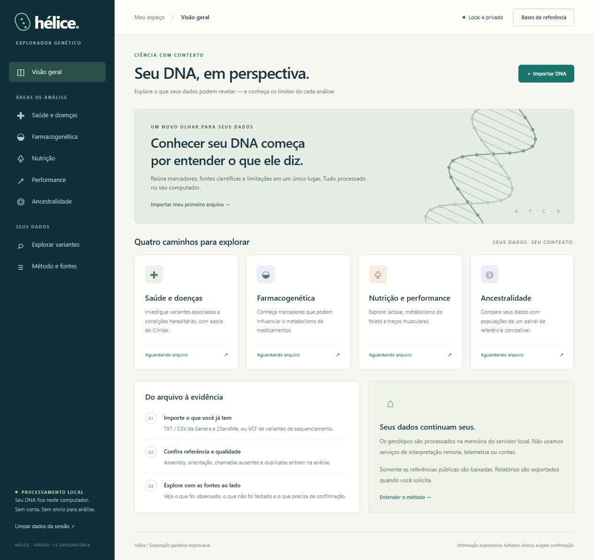

# Hélice — exploração genética local

Aplicativo em português para ler genótipos humanos e variantes já chamadas, conferir qualidade e examinar referências públicas. Processamento no computador do usuário, com interface web em loopback e exportação HTML/JSON/CSV.

**Protótipo exploratório. Sem validação clínica ou populacional externa. Não diagnostica doenças, prescreve medicamentos ou comprova nacionalidades/etnias.**



## Começar

Requisitos: Python 3.11+; NumPy para ancestralidade avançada. Node.js é necessário apenas para os testes JavaScript.

```bash
python -m pip install -r requirements.txt
python server.py --input examples/exemplo_sintetico.vcf
```

No Windows, também é possível abrir `iniciar.cmd`. O navegador abre em `http://127.0.0.1:8765`. Encerre o processo com Ctrl+C quando terminar.

Os exemplos são sintéticos e não representam uma pessoa. Use **Importar DNA** para selecionar seu arquivo local. Um arquivo de chip é genotipagem de posições selecionadas e não equivale a sequenciamento completo.

## Recursos

| Área | Implementado | Limitação |
|---|---|---|
| Importação | TXT/CSV/TSV estilo 23andMe; VCF/VCF.GZ; GRCh37/38; qualidade e duplicatas | FASTQ/BAM/CRAM precisam de pipeline externo; sem normalização de indels com FASTA |
| Genética médica | Matching local de variantes observadas com VCF ClinVar; classificações, conflitos, estrelas e fonte | Não resolve causalidade, penetrância, herança ou exclusão de doença |
| Farmacogenética | Marcadores selecionados e contexto de diretrizes | Sem diplótipos abrangentes, doses ou escolha automática de tratamento |
| Nutrição e performance | Painel exploratório com fontes e limites | Não define dieta, suplementos, treino ou diagnóstico por SNP |
| Ancestralidade | Projeção em frequências fixas NHGRI K=21, poda empírica de LD e reamostragem por blocos | Modelo condicionado à referência; não é classificação étnica ou teste genealógico validado |
| Auditoria | Hashes, referência, chamadas ausentes, filtros, rsID/coordenadas e relatórios | Taxa de chamada não mede cobertura do genoma ou acurácia laboratorial |

## Preparar referências públicas

A clonagem não inclui bancos grandes, genótipos públicos ou painéis populacionais processados. Baixe-os explicitamente:

```bash
python tools/download_clinvar.py GRCh37
python tools/nhgri_ancestry.py --prepare-only
```

Para ancestralidade detalhada de um arquivo próprio:

```bash
python tools/nhgri_ancestry.py --input "caminho/dados.txt" --output reports/ancestralidade_genera.json --bootstrap 200
```

Nenhum genótipo pessoal é enviado para obter referências. Os downloads podem ser grandes e são mantidos apenas na instalação local. Fontes, representação dos alelos e condições de redistribuição: [referências externas](THIRD_PARTY_NOTICES.md).

## Testar

```bash
python -m unittest discover -s tests -v
node --check web/app.js
node tests/test_frontend.cjs
```

Os testes usam fixtures sintéticas e não exigem downloads de bases. A integração contínua verifica Python e JavaScript em Linux e Windows. **Passar nos testes não demonstra acurácia clínica nem novidade científica.** Consulte o [estado da validação](docs/VALIDATION.md).

## Privacidade

- Servidor limitado a `127.0.0.1`, com verificação de Host/Origin e token local nas APIs.
- Genótipos processados na memória; uploads usam temporário local removido após a leitura.
- Sem conta, telemetria, CDN ou serviço remoto de interpretação.
- `.gitignore` usa uma lista positiva: relatórios, genótipos, caches, downloads e ZIPs não entram no versionamento normal.
- Arquivos originais e relatórios exportados permanecem sob responsabilidade do usuário; limpar a sessão não os apaga.

Não abra issues contendo genótipos ou relatórios pessoais. Para reproduzir problemas, produza um exemplo sintético mínimo.

## Documentação

- [Manual e formatos](docs/USAGE.md)
- [Verificação realizada e validação ainda ausente](docs/VALIDATION.md)
- [Critérios para desenvolvimento acadêmico](docs/RESEARCH_ROADMAP.md)
- [Fontes e dados de terceiros](THIRD_PARTY_NOTICES.md)

O repositório mantém o protótipo e seu histórico de desenvolvimento. Nenhuma licença de distribuição foi atribuída ao código nesta etapa privada.
